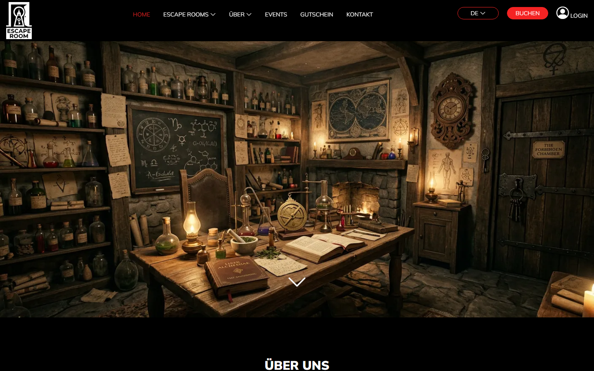
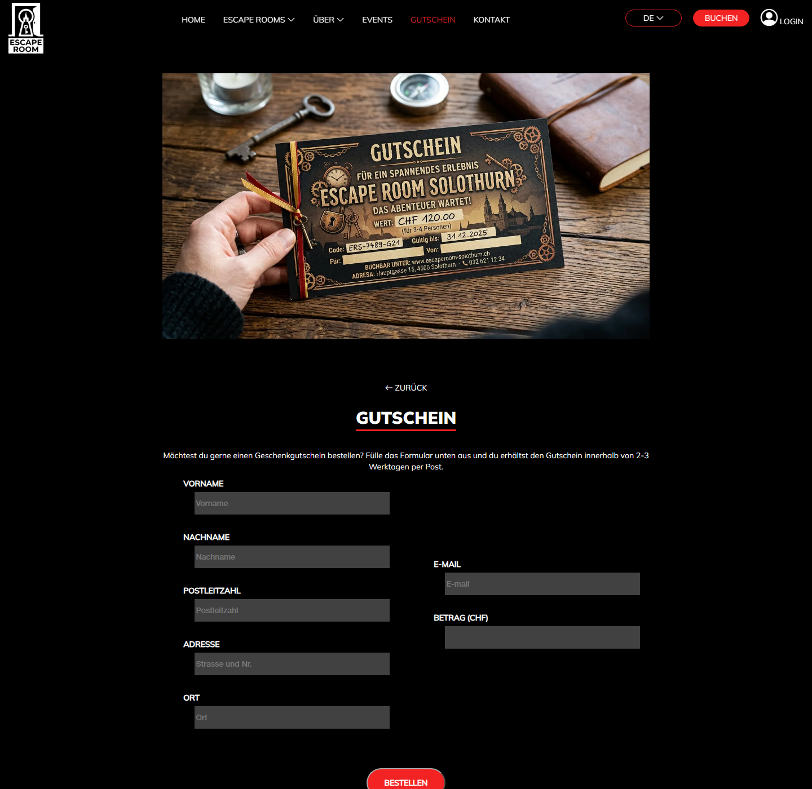
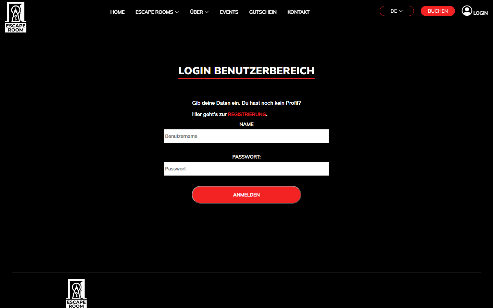
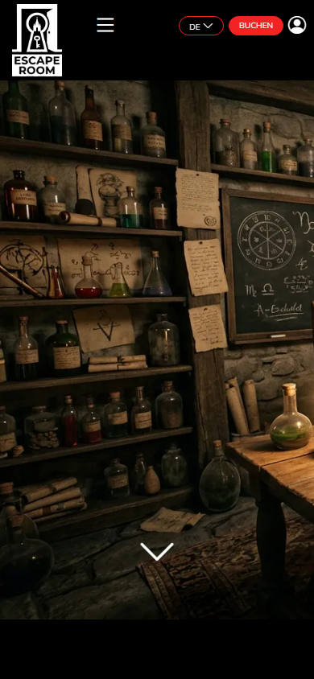

# Escape Rooms Solothurn

Website für einen fiktiven Escape-Room-Anbieter in Solothurn, umgesetzt mit **PHP, MySQL, HTML, CSS und JavaScript** – ohne Framework.

> **Hinweis:** «Escape Rooms Solothurn» ist ein erfundenes Unternehmen. Das Projekt ist ein Übungs- und Portfolio-Projekt. Adressen, Links und Angaben im Footer sind Platzhalter.



## Funktionen

- **Registrierung und Login** – Passwörter werden mit `password_hash()` gespeichert und mit `password_verify()` geprüft. Nach dem Login wird die Session-ID erneuert.
- **Geschützter Benutzerbereich** – persönliche Daten ansehen und bearbeiten, Übersicht über die eigenen Gutschein-Bestellungen.
- **Gutschein bestellen** – als eingeloggter Kunde oder als Gast. Bei Gästen wird automatisch ein Kundenprofil angelegt; beides wird in einer Datenbank-Transaktion gespeichert.
- **Kontaktformular** – Nachrichten werden in der Datenbank gespeichert.
- **Responsive Navigation** mit Burger-Menü und Dropdowns (Vanilla JavaScript).

## Sicherheit

- Alle Datenbankabfragen laufen über **Prepared Statements** (Schutz vor SQL-Injection).
- Alle Ausgaben werden mit `htmlspecialchars()` maskiert (Schutz vor XSS).
- Alle Formulare sind mit einem **CSRF-Token** geschützt.
- Session-Cookies sind `HttpOnly` und `SameSite=Lax`; über HTTPS zusätzlich `Secure`.
- Serverseitige Validierung aller Eingaben (inkl. Umlaute, Schweizer PLZ, Strasse mit Hausnummer).
- Zugangsdaten liegen in einer eigenen Konfigurationsdatei, die nicht im Repository ist.

## Screenshots

| Gutschein bestellen | Login | Mobil |
|---|---|---|
|  |  |  |

## Projektstruktur

```
├── index.php                 Startseite
├── pages/                    Unterseiten (Gutschein, Kontakt, Login, Registrierung, Benutzerbereich)
├── components/               Navigation und Footer (werden in jede Seite eingebunden)
├── includes/                 Datenbank, Session, Hilfsfunktionen, Formular-Validierung
├── css/                      Stylesheets (pro Seite + gemeinsames style.css)
├── js/                       Navigation (Burger-Menü, Dropdowns)
├── img/                      Bilder (WebP)
├── fonts/                    Schrift Mulish (SIL Open Font License)
└── database/
    ├── escaperoom.sql        Datenbankstruktur
    └── demo-daten.sql        Beispieldaten mit Demo-Login (optional)
```

### Datenbank

| Tabelle | Inhalt |
|---|---|
| `kunden_profile` | Name, E-Mail und Adresse (für registrierte Kunden und Gäste) |
| `logindaten` | Benutzername und Passwort-Hash, verknüpft mit `kunden_profile` |
| `gutschein_bestellungen` | Bestellte Gutscheine mit Betrag, Status und Datum |
| `kontakt_nachrichten` | Nachrichten aus dem Kontaktformular |

## Lokal starten (XAMPP)

1. Repository in den Ordner `htdocs` von XAMPP klonen:
   ```bash
   git clone https://github.com/nicolefi/escape-rooms-solothurn.git
   ```
2. In XAMPP **Apache** und **MySQL** starten.
3. In phpMyAdmin (`http://localhost/phpmyadmin`) die Datei `database/escaperoom.sql` importieren.
   Optional danach `database/demo-daten.sql` importieren, um Beispieldaten zu erhalten.
4. `includes/config.example.php` nach `includes/config.php` kopieren und bei Bedarf die Zugangsdaten anpassen.
5. Im Browser öffnen: `http://localhost/escape-rooms-solothurn/`

### Demo-Login

Mit den Demo-Daten kann man sich direkt einloggen und sieht den Benutzerbereich mit einer Bestellung:

| Benutzername | Passwort |
|---|---|
| `demo` | `Demo!123` |

Alle Personen in den Demo-Daten sind erfunden.

Alternativ ohne Apache, mit dem eingebauten PHP-Server:

```bash
php -S localhost:8000
```

Voraussetzungen: PHP 7.4 oder neuer (mit `mysqli`), MySQL bzw. MariaDB.

## Was ich dabei gelernt habe

Es war spannend, wieder ein komplettes Projekt von Grund auf zu entwickeln. Dadurch konnte ich mein Wissen nicht nur auffrischen, sondern gezielt erweitern. Ein besonderer Fokus lag dabei auf Sicherheitsaspekten: Ich habe gelernt, das Prinzip der doppelten Sicherheit durch die Kombination von CSRF-Tokens und dem SameSite-Attribut „Lax“ erfolgreich umzusetzen.

## Mögliche Erweiterungen

- Online-Buchung der Räume mit Kalender
- Detailseiten für die einzelnen Escape Rooms
- E-Mail-Bestätigung bei Registrierung und Bestellung
- Passwort ändern / zurücksetzen

## Credits

- Schrift: [Mulish](https://fonts.google.com/specimen/Mulish) (SIL Open Font License, siehe `fonts/Mulish/OFL.txt`)
- Icons: [Bootstrap Icons](https://icons.getbootstrap.com/)
- Bilder: KI-generiert mit Adobe Firefly
